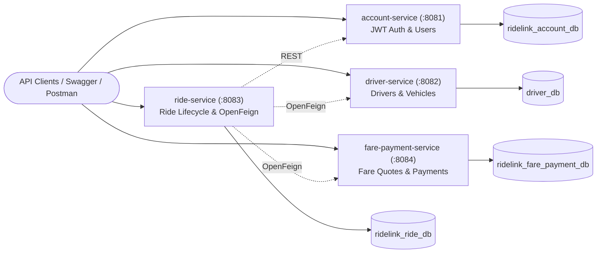

<div align="center">

  

  <p align="center">
    <b>Distributed ride-hailing backend architecture built with Java 21, Spring Boot 3.2.x, Spring Cloud OpenFeign, JWT authentication, and isolated MongoDB databases per microservice.</b>
  </p>

  <p align="center">
    <a href="https://github.com/Sh3hann/RideLink-Backend/actions/workflows/ci.yml"></a>
    
    
    
    
    <a href="LICENSE"></a>
  </p>

</div>

---

## Microservices Architecture

Each service owns its own MongoDB database boundary and communicates exclusively over HTTP REST APIs (with **Spring Cloud OpenFeign** orchestration inside `ride-service`):



---

## Service Matrix

| Microservice | Port | MongoDB Database | Env Override | Spring Boot | OpenAPI & Postman |
| :--- | :--- | :--- | :--- | :--- | :--- |
| **`account-service`** | `8081` | `ridelink_account_db` | `SPRING_DATA_MONGODB_URI`, `JWT_SECRET` | `3.2.3` | [README](account-service/README.md) · [OpenAPI](account-service/openapi-account.json) · [Postman](account-service/postman/Account_Service.postman_collection.json) |
| **`driver-service`** | `8082` | `driver_db` | `MONGO_URI` | `3.2.3` | [README](driver-service/README.md) · [OpenAPI](driver-service/openapi-driver.json) · [Postman](driver-service/postman/Driver_Service.postman_collection.json) |
| **`ride-service`** | `8083` | `ridelink_ride_db` | `MONGODB_URI`, `DRIVER_SERVICE_URL`, `FARE_SERVICE_URL`, `ACCOUNT_SERVICE_URL` | `3.2.5` | [README](ride-service/README.md) · [OpenAPI](ride-service/openapi-ride.json) · [Postman](ride-service/postman/Ride_Service.postman_collection.json) |
| **`fare-payment-service`** | `8084` | `ridelink_fare_payment_db` | `MONGODB_URI` | `3.2.3` | [README](fare-payment-service/README.md) · [OpenAPI](fare-payment-service/openapi-fare.json) · [Postman](fare-payment-service/postman/Fare_%26_Payment_Service.postman_collection.json) |

---

## Prerequisites

- **Java 21 (JDK 21)**
- **Apache Maven 3.8+**
- **MongoDB** (local instance or Docker container on `localhost:27017`)
- **Postman** (optional, for running the bundled API collections)

---

## Quick Start

### 1. Start MongoDB
```bash
docker run -d -p 27017:27017 --name ridelink-mongo mongo:6.0
```

### 2. Recommended Startup Order
Start services in dependency order so ride orchestration can call account, driver, and fare endpoints:

1. **`account-service`** (`8081`) — requires `JWT_SECRET` (at least 32 bytes):
   ```bash
   cd account-service
   export JWT_SECRET="$(openssl rand -base64 32)"
   mvn clean spring-boot:run
   ```
2. **`driver-service`** (`8082`):
   ```bash
   cd driver-service
   mvn clean spring-boot:run
   ```
3. **`fare-payment-service`** (`8084`):
   ```bash
   cd fare-payment-service
   mvn clean spring-boot:run
   ```
4. **`ride-service`** (`8083`) — also supports `docker-compose up` via `ride-service/docker-compose.yml`:
   ```bash
   cd ride-service
   mvn clean spring-boot:run
   ```

---

## Build & Test

Every service includes JUnit 5 unit tests and is verified automatically in [`.github/workflows/ci.yml`](.github/workflows/ci.yml) (`mvn -B clean verify`):

```bash
cd <service-directory>
mvn clean test
mvn clean verify
```

---

## API Documentation & Testing

- **Swagger UI:** `http://localhost:<port>/swagger-ui.html` (available when each service is running)
- **OpenAPI Specs:** Each module includes a pre-exported `openapi-*.json` contract
- **Postman Collections:** Import the `.postman_collection.json` files inside each service's `postman/` directory (plus `ride-service/postman/RideLink_Environment.postman_environment.json`)

---

## Contributors

| Service Ownership | Contributor | Report |
| :--- | :--- | :--- |
| **Account & Access Service** | Member 1 | [Report I1](account-service/MEMBER_REPORT_I1.md) |
| **Driver & Vehicle Service** | Basiron A.S | [Report I2](driver-service/MEMBER_REPORT_I2.md) |
| **Ride Management Service** | Balapatabandige D.H. | [Report I3](ride-service/MEMBER_REPORT_I3.md) |
| **Fare & Payment Service** | Jayawardhana T.N.D.J | [Report I4](fare-payment-service/MEMBER_REPORT_I4.md) |

---

## License

Released under the [MIT License](LICENSE) © 2026 [Akil Shehan](https://github.com/Sh3hann) & Contributors.
